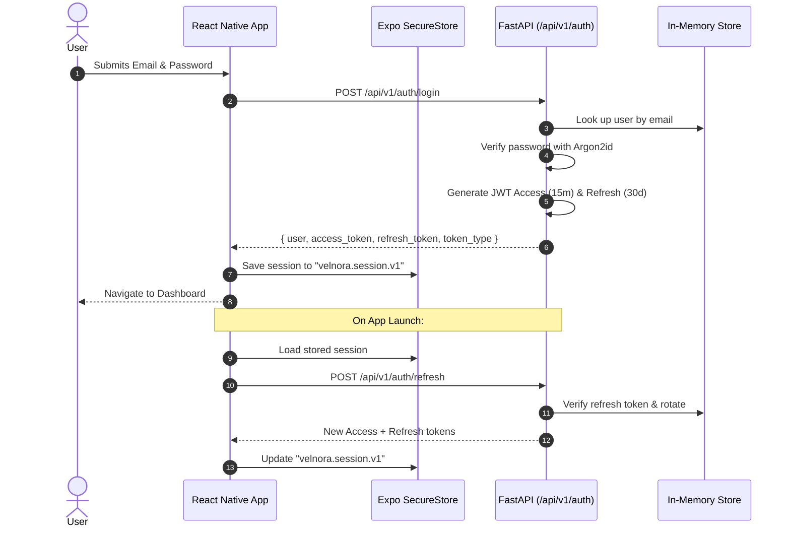
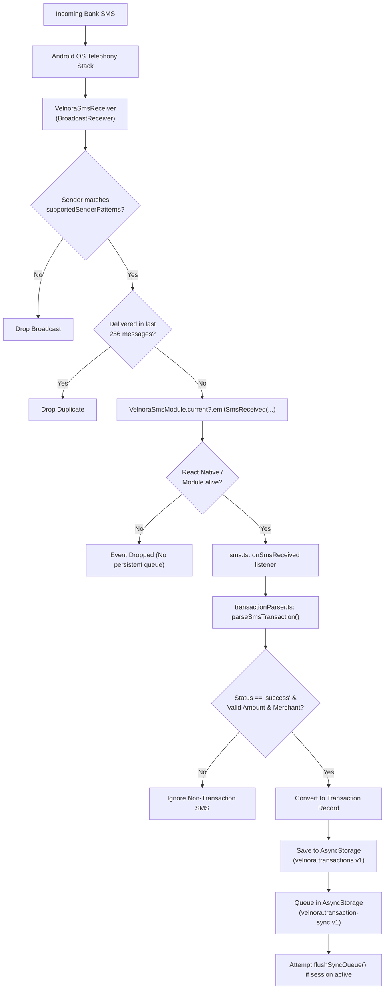

# VELNORA — COMPLETE ARCHITECTURE AUDIT

**Date:** 2026-11-02  
**Auditor:** Mobile Application Architect, Android Engineer, Backend Engineer & Database Architect  
**Repository:** `Suyog-Repal/velnora` (Branch: `main`)  
**Target Platform:** Android (Samsung Galaxy A36)

---

## EXECUTIVE SUMMARY

Velnora is a personal finance management application with a React Native + Expo frontend, a custom native Android Kotlin module for SMS transaction detection, and a Python FastAPI backend.

This audit evaluates the codebase against the objective of building a **secure, production-quality, offline-first Android application with cloud synchronization and multi-device recovery**, backed by **Neon PostgreSQL** and **FastAPI on Render**, while **strictly preserving the existing native Kotlin SMS detection module**.

### High-Level Findings
1. **Frontend Architecture:** The current frontend is an Expo SDK 58 application containing UI views for Home, Transactions, Analytics, Budgets, People, and Profile, along with an Authentication modal flow. However, local storage relies on `@react-native-async-storage/async-storage` storing raw JSON arrays. There is no relational database, no transaction safety, and no indexing.
2. **Native SMS Module:** A custom Expo Kotlin module (`modules/velnora-sms/`) and Expo Config Plugin (`plugins/withVelnoraSms.js`) are fully implemented and functional. The module listens for `SMS_RECEIVED`, performs in-memory deduplication, and emits raw messages to a JavaScript parser (`transactionParser.ts`). **This module is sound, well-integrated into the CI build, and must be preserved.**
3. **Backend Architecture:** The backend in `backend/app/` is a FastAPI application implementing authentication (Argon2id + JWT) and transaction creation. Crucially, **it currently uses an in-memory ledger (`InMemoryLedger`) and in-memory user store (`AuthStore`)**. No database connection, no SQLAlchemy ORM models, and no Alembic migrations are currently active. All records are lost when the FastAPI process terminates.
4. **Cloud Database / Supabase References:** A comprehensive codebase scan revealed **zero references to Supabase** (`grep -ri "supabase" .` yielded 0 results). There are no existing Supabase dependencies, tables, or client configurations.
5. **CI/CD & Android Build:** A production-ready GitHub Actions workflow (`.github/workflows/build-android.yml`) exists. It successfully automates Expo prebuilding, autolinks the custom Kotlin SMS module, compiles release JavaScript bundles with Hermes, and builds a standalone release APK via Gradle.

---

## 1. COMPREHENSIVE CODEBASE INVENTORY

### 1.1 Frontend Codebase
| File | Status | Description |
|---|---|---|
| `package.json` | Active | Expo SDK `~58.0.21`, React `19.3.0`, React Native `0.88.1`. Dependencies include `async-storage`, `expo-secure-store`, `lucide-react-native`, `react-native-svg`. Missing `expo-sqlite` and `@react-native-community/netinfo`. |
| `app.json` | Active | Defines `name: "velnora"`, `package: "com.anonymous.velnora"`, and registers config plugin `./plugins/withVelnoraSms` with sender regex `^[\w0-9 -]{4,30}$`. |
| `App.tsx` | Active | Monolithic root component (156 lines). Manages navigation tabs, auth state, local state, and inline UI rendering. Reads/writes transactions to `AsyncStorage` (`velnora.transactions.v1`). |
| `auth.ts` | Active | Client authentication and API layer. Uses `expo-secure-store` for session storage (`velnora.session.v1`). Communicates with backend endpoints under `/api/v1/auth/*` and `/api/v1/transactions`. |
| `sms.ts` | Active | Bridge to native Kotlin module `VelnoraSms`. Provides runtime permission request (`RECEIVE_SMS`), listener subscription (`addSmsReceivedListener`), and pattern configuration. |
| `transactionParser.ts` | Active | Pure TypeScript parser extracting debit/credit amounts, merchants, dates, and reference numbers from SMS text. Generates FNV-1a hash fingerprint. |
| `transactionParser.test.js` | Active | Unit tests for SMS status classification, extraction, and deduplication fingerprints. Passes completely (`npm test`). |
| `theme.ts` & `icons.ts` | Active | Dark/light theme palette, storage hook (`AsyncStorage`), and Lucide icon re-exports. |
| `tsconfig.json` | Active | Extends `expo/tsconfig.base` with strict mode enabled. |

### 1.2 Native Android Module & Config Plugin
| File | Status | Description |
|---|---|---|
| `modules/velnora-sms/expo-module.config.json` | Active | Declares Expo Android module `com.velnora.sms.VelnoraSmsModule`. |
| `modules/velnora-sms/package.json` | Active | Module package `@velnora/sms` version 1.0.0. Autolinked via root `package.json`. |
| `modules/velnora-sms/android/build.gradle` | Active | Android library Gradle config with namespace `com.velnora.sms` and Expo module plugin. |
| `VelnoraSmsModule.kt` | Active | Native Expo module. Exposes `setSupportedSenderPatterns`, `isReceiveSmsPermissionGranted`, and event `onSmsReceived`. Maintains static singleton reference for the receiver. |
| `VelnoraSmsReceiver.kt` | Active | Android `BroadcastReceiver` listening for `Telephony.Sms.Intents.SMS_RECEIVED_ACTION`. Extracts multipart PDU messages, matches sender regex against manifest metadata, and applies a 256-entry LRU deduplication cache (`sender:timestamp:partCount`). |
| `plugins/withVelnoraSms.js` | Active | Expo Config Plugin injecting `android.permission.RECEIVE_SMS`, the `VelnoraSmsReceiver` receiver definition with `BROADCAST_SMS` permission, and pattern metadata into `AndroidManifest.xml`. |

### 1.3 Backend Codebase
| File | Status | Description |
|---|---|---|
| `backend/requirements.txt` | Incomplete | Lists `fastapi==0.115.6`, `uvicorn[standard]==0.34.0`, `pydantic==2.10.5`, `sqlalchemy==2.0.37`, `aiosqlite==0.20.0`, `argon2-cffi==23.1.0`, `PyJWT==2.10.1`, `email-validator==2.2.0`. Missing PostgreSQL driver (`psycopg[binary]` or `asyncpg`) and `alembic`. |
| `backend/app/main.py` | Incomplete | FastAPI application entry point. Implements `/api/v1/health`, `/api/v1/auth/*`, and `/api/v1/transactions`. Storage uses in-memory dicts (`InMemoryLedger`). |
| `backend/app/auth.py` | Incomplete | In-memory `AuthStore` using Argon2id for password hashing and PyJWT for HS256 tokens. Access tokens expire in 15 min; refresh tokens expire in 30 days with rotation. |
| `backend/app/models.py` | Incomplete | Contains only lightweight Pydantic schemas (`Direction`, `TransactionPayload`, `TransactionIdentity`). No SQLAlchemy models exist. |
| `backend/app/services.py` | Active | Utility functions (`recorded_flow`). |
| `backend/app/test_*.py` | Active | Test suite for auth, API, and ledger logic. |
| `.env.example` | Active | Documents environment variables (`DATABASE_URL`, `VELNORA_JWT_SECRET`, `EXPO_PUBLIC_API_URL`, `VELNORA_CORS_ORIGINS`). |

### 1.4 CI/CD & Build Infrastructure
| File | Status | Description |
|---|---|---|
| `.github/workflows/build-android.yml` | Production-Ready | GitHub Actions workflow that installs Node 22, Temurin Java 17, Android SDK 35, builds the Expo prebuild, validates SMS module autolinking, verifies receiver manifest injection, and compiles the standalone release APK (`app-release.apk`) using Gradle. |

---

## 2. DETAILED AUDIT CRITERIA (10 CORE POINTS)

### 2.1 What Already Exists
- **Mobile Frontend:** Complete visual design and navigation for 6 tabs: Home (balance, cash flow, recent activity), Transactions (search, type filter, category filter), Analytics (spending breakdown), Budgets (placeholder cards), People (counterparty breakdown), and Profile (user card, theme toggle, logout).
- **Authentication UI & Logic:** Welcome screen, Sign Up, Sign In, Forgot Password dialogs, form validation, password strength rules, and SecureStore session handling.
- **Native Android SMS Extraction:** Complete Kotlin SMS receiver that detects bank messages without internet connection, enforces regex filtering, and passes payloads to the JS runtime.
- **SMS Parser:** Pure JS regex parser with unit tests that extract transaction amount, currency, merchant/counterparty, direction (credit/debit), and reference ID.
- **Backend API Contract:** Typed FastAPI REST endpoints with UUID identifiers, decimal amounts, bearer JWT authentication, and CORS middleware.
- **Standalone Android Release CI:** Complete GitHub Actions pipeline configured for Gradle release APK generation.

### 2.2 What Currently Works
- Offline transaction creation in the mobile UI (persisting to `AsyncStorage`).
- SMS message capture and transaction parsing while the application is active.
- Password hashing using Argon2id and JWT access/refresh token generation.
- Secure storage of tokens via `Expo SecureStore`.
- SMS module autolinking and manifest injection during Expo prebuild.
- All unit tests for SMS transaction parsing pass (`npm test`).

### 2.3 What Is Incomplete
- **No SQLite Persistence on Android:** Transactions and sync queue are stored as unindexed, unversioned JSON blobs in `AsyncStorage`. If the app records hundreds of transactions, performance degrades and concurrent writes can cause data corruption.
- **No Cloud Database Persistence:** The backend holds all accounts, sessions, and transactions in volatile memory (`InMemoryLedger` and `AuthStore`). Terminating or restarting the FastAPI process on Render immediately deletes all users and transactions.
- **No Database Models or Migrations:** SQLAlchemy models for Users, Profiles, Transactions, Categories, Devices, and Sync Metadata are absent. Alembic is not initialized.
- **No Two-Way Synchronization Engine:** The mobile app only has a naive one-way `flushSyncQueue` function that posts transactions to `/api/v1/transactions`. There is no pull synchronization (`/sync/pull`), no incremental cursor tracking, no tombstoning for deletions, and no conflict resolution.
- **No Multi-Device Recovery:** Logging in on a second device leaves the local database empty because the app never pulls the user's historical cloud transactions upon authentication.
- **No Connectivity Monitoring:** No NetInfo implementation to detect offline/online transitions or trigger background retries upon reconnection.
- **No UI Synchronization State:** The UI gives no visual feedback about whether a transaction is saved only locally, pending synchronization, or safely backed up to the cloud.
- **Missing API Operations:** No endpoints for `PUT /transactions/{id}` (editing), `DELETE /transactions/{id}` (deletion/tombstoning), `GET /profile`, or `/sync/*`.

### 2.4 What Needs Modification
1. **Frontend Storage Layer:** Replace `AsyncStorage` transaction operations with a robust SQLite architecture using `expo-sqlite`.
2. **Frontend Architecture:** Decouple monolithic `App.tsx` into modular repositories, services, and sync orchestrators (`TransactionRepository`, `CategoryRepository`, `SyncService`, `ConnectivityService`).
3. **Backend Storage Layer:** Replace in-memory dictionaries with PostgreSQL tables via SQLAlchemy and connection pooling suitable for Neon.
4. **Backend Dependencies:** Add `psycopg[binary]` (or `asyncpg`) and `alembic` to `backend/requirements.txt`.
5. **Backend Authentication:** Store users and refresh tokens in PostgreSQL tables to ensure sessions survive restarts.
6. **Backend Sync Endpoints:** Implement `/api/v1/sync/push`, `/api/v1/sync/pull`, and `/api/v1/sync/status`.
7. **Frontend Sync Queue:** Implement persistent SQLite sync queue with retry counters, error codes, and exponential backoff.
8. **Frontend UI:** Add sync badges (Synced, Pending, Offline, Failed) and last synchronized timestamp indicators.

### 2.5 What Can Be Reused
- **Native Android Module:** `modules/velnora-sms/android/src/main/java/com/velnora/sms/VelnoraSmsModule.kt` and `VelnoraSmsReceiver.kt` are 100% reusable and must be preserved.
- **Expo Config Plugin:** `plugins/withVelnoraSms.js` is 100% reusable.
- **SMS JS Bridge & Parser:** `sms.ts`, `transactionParser.ts`, and `transactionParser.test.js`.
- **UI Screens & Styling:** `theme.ts`, `icons.ts`, and the UI layout of Home, Transactions, Analytics, Budgets, People, Profile, and Auth screens.
- **Security Primitives:** Argon2id configuration and JWT token issuance structure from `backend/app/auth.py`.
- **GitHub Actions Workflow:** `.github/workflows/build-android.yml`.

### 2.6 What Should Not Be Changed
- The package name `com.anonymous.velnora` and native module namespace `com.velnora.sms`.
- The native broadcast receiver intent filter (`android.provider.Telephony.SMS_RECEIVED`).
- The privacy boundary: Raw SMS text must **never** be logged, stored in the cloud database, or transmitted over network APIs.
- The color scheme, typography, and visual brand identity.
- The Android SDK and Gradle versions in the build workflow.

---

## 3. EXISTING SYSTEM ARCHITECTURES IN DEPTH

### 3.1 Existing Database Structure
- **Local (Mobile):**  
  - Key `velnora.transactions.v1` in `AsyncStorage`: Contains a serialized JSON array of transaction objects `{ id, amount, direction, counterparty, category, description, date, source, referenceId, fingerprint }`.
  - Key `velnora.transaction-sync.v1` in `AsyncStorage`: Contains a serialized JSON array of pending transactions.
- **Cloud (Backend):**  
  - In-memory dictionary `InMemoryLedger.transactions: dict[UUID, Transaction]`.
  - In-memory dictionary `AuthStore.users_by_email: dict[str, UserRecord]`.
  - In-memory dictionary `AuthStore.users_by_id: dict[UUID, UserRecord]`.
- **Supabase Status:** Confirmed nonexistent. No tables, no client, no credentials.

### 3.2 Existing Authentication Flow


### 3.3 Existing SMS Architecture


---

## 4. DEFICIENCIES & ARCHITECTURAL GAPS

1. **Storage Volatility:** The backend loses all data upon container restart or deployment on Render.
2. **No Data Integrity on Mobile:** `AsyncStorage` does not support ACID transactions, foreign keys, or indexes.
3. **No Incremental Synchronization:** The backend lacks sync endpoints (`/sync/push`, `/sync/pull`). The client cannot request records modified since a specific timestamp/cursor.
4. **No Conflict Resolution:** Changes on multiple devices cannot be reconciled without server-managed versioning or last-write-wins tombstones.
5. **No Multi-Device Recovery:** A user signing into a new device has no mechanism to hydrate local storage from the server.
6. **No Network Awareness:** The app does not detect when network returns to flush offline queues automatically.
7. **Offline Unauthenticated Transactions:** Transactions created while logged out are not tracked with account association status, risking data leakage or accidental overwrite upon subsequent login.

---

## 5. PROPOSED TARGET ARCHITECTURE & MIGRATION STRATEGY

### Target System Architecture
```
+-------------------------------------------------------------------+
|                        ANDROID APPLICATION                        |
|                                                                   |
|  +--------------------+  +--------------------+  +--------------+ |
|  | Presentation Layer |  | Kotlin SMS Module  |  | Connectivity | |
|  | - Dashboard & Tabs |  | - BroadcastReceiver|  | - NetInfo    | |
|  | - Sync Indicators  |  | - In-Memory Dedupe |  | - State Hook | |
|  +---------+----------+  +---------+----------+  +-------+------+ |
|            |                       |                     |        |
|  +---------v-----------------------v---------------------v------+ |
|  |             Application & Service Layer                      | |
|  |  - TransactionService     - CategoryService                  | |
|  |  - SyncEngine (Push/Pull) - AuthenticationService            | |
|  +---------------------------------+----------------------------+ |
|                                    |                              |
|  +---------------------------------v----------------------------+ |
|  |             Local Persistence (Expo SQLite)                  | |
|  |  - transactions (UUID, sync_status, version, deleted_at)     | |
|  |  - categories   - sync_queue   - schema_migrations           | |
|  +---------------------------------+----------------------------+ |
+------------------------------------|------------------------------+
                                     | HTTPS (JWT Bearer)
+------------------------------------v------------------------------+
|                   BACKEND: FASTAPI ON RENDER                      |
|                                                                   |
|  +----------------------+ +------------------+ +---------------+  |
|  | /api/v1/auth Router  | | /transactions    | | /api/v1/sync  |  |
|  | - Argon2id + JWT     | | - Scoped CRUD    | | - Push / Pull |  |
|  +----------+-----------+ +--------+---------+ +-------+-------+  |
|             |                      |                   |          |
|  +----------v----------------------v-------------------v-------+  |
|  |           SQLAlchemy ORM + Connection Pool (Neon)           |  |
|  +---------------------------------+---------------------------+  |
+------------------------------------|------------------------------+
                                     | SSL / TLS
+------------------------------------v------------------------------+
|                     DATABASE: NEON POSTGRESQL                     |
|                                                                   |
|  - users              - user_profiles       - transactions        |
|  - categories         - devices             - alembic_version     |
+-------------------------------------------------------------------+
```

---

## 6. AUDIT CONCLUSION

The Velnora repository provides an excellent base:
- The UI presentation layer is cleanly structured.
- The native Kotlin SMS detection module is robust, well-engineered, and autolinked.
- The build pipeline produces release APKs reliably.

The primary architectural requirement is to **replace volatile in-memory/JSON storage with true relational databases** (Expo SQLite on Android, Neon PostgreSQL on the cloud) and interconnect them via an **idempotent, offline-first synchronization engine**.

Proceed to the implementation plan for the phase-by-phase execution roadmap.
