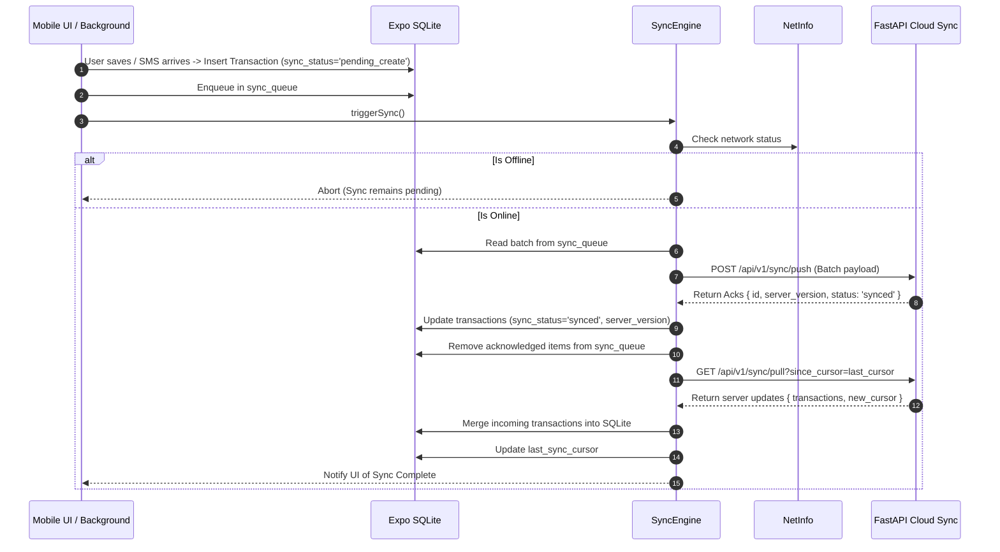

# VELNORA — OFFLINE-FIRST ARCHITECTURE IMPLEMENTATION PLAN

**Date:** 2026-11-02  
**Target:** Production-Grade Offline-First Android App with Cloud Sync and Multi-Device Recovery  
**Author:** Mobile Application Architect & DevOps Engineer  
**Status:** Awaiting User Approval (Step 1 Complete)

---

## 1. ARCHITECTURAL BLUEPRINT & PRINCIPLES

### 1.1 Core Principles
1. **Local-First Ground Truth:** The Android client reads from and writes to local SQLite storage immediately. No UI interaction depends on a live network response.
2. **Deterministic Idempotency:** All transactions generate stable UUID v4 identifiers locally at creation. Repeated uploads or retried synchronization requests never create duplicate cloud records.
3. **Strict Separation of Concerns:** UI components interact exclusively with high-level services and repositories, never directly with raw SQL queries or HTTP endpoints.
4. **Preservation of Native Modules:** The existing Kotlin SMS module (`modules/velnora-sms/`) and Expo Config Plugin (`plugins/withVelnoraSms.js`) remain untouched in their core detection logic; their emitted events are routed directly to SQLite.
5. **Zero Trust & Row-Level Tenant Isolation:** The backend derives user identity solely from verified JWT tokens. Client-provided `user_id` fields are ignored.
6. **Privacy First:** Raw SMS messages are never uploaded, logged to disk, or stored in PostgreSQL.

---

## 2. PHASE-BY-PHASE IMPLEMENTATION ROADMAP

```mermaid
flowchart TD
    Audit["Step 1: Architecture Audit (Complete)"] --> Phase1["Phase 1: Local SQLite Storage & Repositories"]
    Phase1 --> Gate1{"User Approval Gate 1"}
    Gate1 -- Approved --> Phase2["Phase 2: Neon PostgreSQL & SQLAlchemy Models"]
    Phase2 --> Gate2{"User Approval Gate 2"}
    Gate2 -- Approved --> Phase3["Phase 3: FastAPI Backend & Auth Integration"]
    Phase3 --> Gate3{"User Approval Gate 3"}
    Gate3 -- Approved --> Phase4["Phase 4: Two-Way Synchronization Engine"]
    Phase4 --> Gate4{"User Approval Gate 4"}
    Gate4 -- Approved --> Phase5["Phase 5: Kotlin SMS Module & SQLite Pipeline"]
    Phase5 --> Gate5{"User Approval Gate 5"}
    Gate5 -- Approved --> Phase6["Phase 6: Multi-Device Recovery & Data Isolation"]
    Phase6 --> Gate6{"User Approval Gate 6"}
    Gate6 -- Approved --> Phase7["Phase 7: UI Sync Indicators & SQLite Hooking"]
    Phase7 --> Gate7{"User Approval Gate 7"}
    Gate7 -- Approved --> Phase8["Phase 8: Render & Neon Deployment"]
    Phase8 --> Gate8{"User Approval Gate 8"}
    Gate8 -- Approved --> Phase9["Phase 9: Comprehensive Security & Edge Testing"]
    Phase9 --> Gate9{"User Approval Gate 9"}
    Gate9 -- Approved --> Phase10["Phase 10: Release APK Verification & Build"]
```



---

## 3. PHASE DETAILS & SPECIFICATIONS

### PHASE 1: LOCAL SQLITE DATABASE

#### 1.1 Dependencies
- Add `expo-sqlite` (`~15.1.x` matching Expo SDK 58).
- Verify compatibility with Expo prebuild and Hermes runtime.

#### 1.2 Database Architecture (`src/db/`)
- `src/db/database.ts`: Database connection management, PRAGMA configuration (`journal_mode = WAL`, `foreign_keys = ON`).
- `src/db/migrations.ts`: Sequential, versioned database migrations.
- `src/db/repositories/transactionRepository.ts`: CRUD operations, pagination, filtering by date/category/status.
- `src/db/repositories/categoryRepository.ts`: Default seed categories and user-defined categories.
- `src/db/repositories/syncQueueRepository.ts`: Enqueuing, updating retry counts, dequeuing synchronized records.

#### 1.3 SQLite Table Definitions
```sql
-- 1. Schema Migrations Table
CREATE TABLE IF NOT EXISTS schema_migrations (
    version INTEGER PRIMARY KEY,
    applied_at TIMESTAMP DEFAULT CURRENT_TIMESTAMP
);

-- 2. Categories Table
CREATE TABLE IF NOT EXISTS categories (
    id TEXT PRIMARY KEY,
    user_id TEXT,
    name TEXT NOT NULL,
    transaction_type TEXT NOT NULL CHECK(transaction_type IN ('income', 'expense', 'both')),
    icon TEXT,
    created_at TEXT NOT NULL,
    updated_at TEXT NOT NULL
);

-- 3. Transactions Table
CREATE TABLE IF NOT EXISTS transactions (
    id TEXT PRIMARY KEY,
    user_id TEXT,
    amount REAL NOT NULL CHECK(amount > 0),
    direction TEXT NOT NULL CHECK(direction IN ('income', 'expense')),
    counterparty TEXT NOT NULL,
    category_id TEXT,
    category TEXT NOT NULL,
    description TEXT DEFAULT '',
    transaction_date TEXT NOT NULL,
    source TEXT NOT NULL CHECK(source IN ('manual', 'sms')),
    reference_id TEXT,
    fingerprint TEXT,
    sync_status TEXT NOT NULL CHECK(sync_status IN ('synced', 'pending_create', 'pending_update', 'pending_delete', 'failed')),
    server_version INTEGER DEFAULT 1,
    deleted_at TEXT DEFAULT NULL,
    created_at TEXT NOT NULL,
    updated_at TEXT NOT NULL,
    FOREIGN KEY (category_id) REFERENCES categories(id) ON DELETE SET NULL
);

CREATE INDEX IF NOT EXISTS idx_transactions_user ON transactions(user_id);
CREATE INDEX IF NOT EXISTS idx_transactions_date ON transactions(transaction_date DESC);
CREATE INDEX IF NOT EXISTS idx_transactions_sync ON transactions(sync_status);
CREATE INDEX IF NOT EXISTS idx_transactions_reference ON transactions(reference_id);
CREATE INDEX IF NOT EXISTS idx_transactions_fingerprint ON transactions(fingerprint);

-- 4. Devices Table
CREATE TABLE IF NOT EXISTS devices (
    device_id TEXT PRIMARY KEY,
    user_id TEXT,
    device_name TEXT NOT NULL,
    last_sync_at TEXT,
    created_at TEXT NOT NULL
);

-- 5. Sync Queue Table
CREATE TABLE IF NOT EXISTS sync_queue (
    id TEXT PRIMARY KEY,
    entity_type TEXT NOT NULL CHECK(entity_type IN ('transaction', 'category', 'device')),
    entity_id TEXT NOT NULL,
    operation TEXT NOT NULL CHECK(operation IN ('create', 'update', 'delete')),
    payload TEXT NOT NULL,
    retry_count INTEGER NOT NULL DEFAULT 0,
    last_attempt_at TEXT,
    next_retry_at TEXT,
    error_code TEXT,
    created_at TEXT NOT NULL
);

CREATE INDEX IF NOT EXISTS idx_sync_queue_retry ON sync_queue(next_retry_at, retry_count);
```

#### 1.4 Verification & Acceptance Criteria
- Unit tests validating:
  - Database initialization and PRAGMA settings.
  - Adding transactions offline persists to disk.
  - Restarting app process retains all transactions.
  - Updating and soft-deleting transactions updates `sync_status` and `deleted_at`.
  - Duplicate reference IDs/fingerprints are rejected or handled gracefully.

---

### PHASE 2: NEON POSTGRESQL & CLOUD MODELS

#### 2.1 Backend Dependencies (`backend/requirements.txt`)
- `fastapi==0.115.6`
- `uvicorn[standard]==0.34.0`
- `pydantic==2.10.5`
- `pydantic-settings==2.7.1`
- `sqlalchemy==2.0.37`
- `psycopg[binary]==3.2.4`
- `alembic==1.14.1`
- `argon2-cffi==23.1.0`
- `PyJWT==2.10.1`
- `email-validator==2.2.0`

#### 2.2 SQLAlchemy Models (`backend/app/db/models.py`)
```python
# Models Structure
class User(Base):
    __tablename__ = "users"
    id = Column(UUID(as_uuid=True), primary_key=True, default=uuid4)
    email = Column(String(255), unique=True, nullable=False, index=True)
    password_hash = Column(String(255), nullable=False)
    account_status = Column(String(32), default="active", nullable=False)
    created_at = Column(DateTime(timezone=True), default=lambda: datetime.now(timezone.utc), nullable=False)
    updated_at = Column(DateTime(timezone=True), default=lambda: datetime.now(timezone.utc), onupdate=lambda: datetime.now(timezone.utc), nullable=False)

    profile = relationship("UserProfile", back_populates="user", uselist=False, cascade="all, delete-orphan")
    transactions = relationship("Transaction", back_populates="user", cascade="all, delete-orphan")
    categories = relationship("Category", back_populates="user", cascade="all, delete-orphan")
    devices = relationship("Device", back_populates="user", cascade="all, delete-orphan")
    refresh_tokens = relationship("RefreshToken", back_populates="user", cascade="all, delete-orphan")

class UserProfile(Base):
    __tablename__ = "user_profiles"
    id = Column(UUID(as_uuid=True), primary_key=True, default=uuid4)
    user_id = Column(UUID(as_uuid=True), ForeignKey("users.id", ondelete="CASCADE"), unique=True, nullable=False)
    display_name = Column(String(120), nullable=False)
    preferences = Column(JSON, default=dict, nullable=False)
    created_at = Column(DateTime(timezone=True), default=lambda: datetime.now(timezone.utc), nullable=False)
    updated_at = Column(DateTime(timezone=True), default=lambda: datetime.now(timezone.utc), onupdate=lambda: datetime.now(timezone.utc), nullable=False)

class Transaction(Base):
    __tablename__ = "transactions"
    id = Column(UUID(as_uuid=True), primary_key=True) # Stable client UUID
    user_id = Column(UUID(as_uuid=True), ForeignKey("users.id", ondelete="CASCADE"), nullable=False, index=True)
    amount = Column(Numeric(12, 2), nullable=False)
    direction = Column(String(16), nullable=False)
    counterparty = Column(String(160), nullable=False)
    category = Column(String(80), nullable=False)
    category_id = Column(UUID(as_uuid=True), ForeignKey("categories.id", ondelete="SET NULL"), nullable=True)
    description = Column(String(500), default="", nullable=False)
    transaction_date = Column(DateTime(timezone=True), nullable=False, index=True)
    source = Column(String(16), nullable=False) # manual | sms
    reference_id = Column(String(160), nullable=True)
    fingerprint = Column(String(64), nullable=True)
    version = Column(Integer, default=1, nullable=False)
    deleted_at = Column(DateTime(timezone=True), nullable=True, index=True)
    created_at = Column(DateTime(timezone=True), default=lambda: datetime.now(timezone.utc), nullable=False)
    updated_at = Column(DateTime(timezone=True), default=lambda: datetime.now(timezone.utc), onupdate=lambda: datetime.now(timezone.utc), nullable=False)

    __table_args__ = (
        UniqueConstraint("user_id", "reference_id", name="uq_user_reference_id"),
        UniqueConstraint("user_id", "fingerprint", name="uq_user_fingerprint"),
        Index("idx_user_updated", "user_id", "updated_at"),
    )

class RefreshToken(Base):
    __tablename__ = "refresh_tokens"
    id = Column(UUID(as_uuid=True), primary_key=True, default=uuid4)
    user_id = Column(UUID(as_uuid=True), ForeignKey("users.id", ondelete="CASCADE"), nullable=False, index=True)
    token_hash = Column(String(255), unique=True, nullable=False)
    revoked = Column(Boolean, default=False, nullable=False)
    expires_at = Column(DateTime(timezone=True), nullable=False)
    created_at = Column(DateTime(timezone=True), default=lambda: datetime.now(timezone.utc), nullable=False)
```

#### 2.3 Database Connection & Alembic
- Configure `engine` with `pool_size=5`, `max_overflow=10`, `pool_pre_ping=True` (essential for Neon serverless scale-to-zero).
- Initialize Alembic: `alembic init alembic`.
- Create baseline migration `001_initial_schema.py`.

---

### PHASE 3: FASTAPI BACKEND ENHANCEMENTS

#### 3.1 Endpoint Specifications
- **Auth Router (`/api/v1/auth`):**
  - `POST /register`: Accepts `full_name`, `email`, `password`, `terms_accepted`. Hashes password with Argon2id, creates `User` & `UserProfile`, issues JWTs.
  - `POST /login`: Validates credentials against DB, issues access (15m) + refresh (30d) tokens.
  - `POST /refresh`: Rotates refresh token in DB, revoking previous token.
  - `POST /logout`: Marks refresh token as revoked in DB.
  - `GET /me`: Returns current user identity.
- **Transactions Router (`/api/v1/transactions`):**
  - `GET /`: Paginated list of user transactions with filters (`direction`, `category`, `since`).
  - `POST /`: Upsert transaction with client-supplied UUID. Idempotent.
  - `PUT /{id}`: Update transaction; increments version.
  - `DELETE /{id}`: Soft-delete (sets `deleted_at`, increments version).
- **Profile Router (`/api/v1/profile`):**
  - `GET /`: Returns user profile.
  - `PUT /`: Updates user display name and preferences.

---

### PHASE 4: OFFLINE-FIRST SYNCHRONIZATION ENGINE

#### 4.1 Sync Protocols & Endpoints
- **Push Endpoint:** `POST /api/v1/sync/push`
  - Accepts batch of queued local changes: `[ { entity_type, entity_id, operation, payload, client_version } ]`.
  - Processes each item in a database transaction.
  - If server version > client version on update: conflict resolved via Last-Write-Wins (or merge if non-conflicting fields).
  - Returns array of acknowledgements: `[ { entity_id, status: 'synced' | 'conflict_rejected', server_version } ]`.
- **Pull Endpoint:** `GET /api/v1/sync/pull?since_cursor=<timestamp>`
  - Returns all records created, updated, or soft-deleted where `updated_at > since_cursor`.
  - Returns `new_cursor` and `has_more` for pagination.
- **Sync Status Endpoint:** `GET /api/v1/sync/status`
  - Returns server timestamp, user transaction count, and last sync anchor.

#### 4.2 Mobile Sync Engine Implementation (`src/services/syncEngine.ts`)


#### 4.3 Exponential Backoff & Retry Policy
- Retries scheduled at: $2^n \times 1000\text{ms}$ with jitter, capped at 5 minutes.
- Maximum retry attempts: 10. Items exceeding limit are marked `failed` and surfaced to user for manual retry.
- Immediate retry triggered on NetInfo transition: `isConnected: false -> true`.

---

### PHASE 5: NATIVE SMS MODULE INTEGRATION

#### 5.1 Architecture & Preservation
- Preserve `modules/velnora-sms/android/src/main/java/com/velnora/sms/VelnoraSmsModule.kt` and `VelnoraSmsReceiver.kt`.
- Maintain manifest injection in `plugins/withVelnoraSms.js`.
- Route incoming events directly through `transactionParser.ts` into `TransactionRepository.insertFromSms()`.
- Set `source = 'sms'`, `sync_status = 'pending_create'`, compute `fingerprint`, and enqueue in `sync_queue`.
- When online, `SyncEngine` uploads transaction without transmitting the raw message body.

---

### PHASE 6: MULTI-DEVICE RECOVERY & USER ISOLATION

#### 6.1 Multi-Device Flow
1. User installs Velnora on a secondary Android device.
2. User enters credentials and logs in via `/api/v1/auth/login`.
3. Client registers device in backend (`POST /api/v1/devices`).
4. Client triggers complete initial pull (`GET /api/v1/sync/pull?since_cursor=0`).
5. Client batches inserted transactions into local SQLite inside a single SQLite transaction.
6. Local dashboard renders restored financial history immediately.

#### 6.2 Offline-to-Authenticated Association
- If a user records transactions offline prior to logging in (`user_id IS NULL`):
  - On login, app detects unassociated transactions.
  - Presents modal prompt: *"Would you like to import X transactions recorded on this device into your account [Email]?"*
  - If approved, updates `user_id` to authenticated user ID and triggers sync push.
  - If rejected, isolates records or provides data reset.

---

### PHASE 7: UI INTEGRATION & SYNC STATUS

#### 7.1 Visual Sync Indicators
- **Header Badge:**
  - 🟢 `Synced` (All records backed up to cloud).
  - 🟡 `Syncing...` (Transfer in progress).
  - 🟠 `Pending (N)` (Changes waiting for connection).
  - ⚪ `Offline` (Network unavailable, operating locally).
  - 🔴 `Sync Failed` (Tap to view details or retry).
- **Transaction Item Status:**
  - Cloud icon with checkmark for `synced`.
  - Clock icon for `pending`.
- **Last Cloud Sync:** Displays relative time (e.g., *"Backed up 2 minutes ago"*).

#### 7.2 Connecting Screens to SQLite
- Refactor `HomeScreen`, `TransactionsScreen`, `AnalyticsScreen`, and `PeopleScreen` to consume reactive hooks from SQLite database.

---

### PHASE 8: PRODUCTION DEPLOYMENT (NEON & RENDER)

#### 8.1 Neon PostgreSQL Setup
1. Create project `velnora-db` on Neon console.
2. Obtain pooled connection URI: `postgresql+psycopg://<user>:<pass>@<endpoint>-pooler.neon.tech/velnora?sslmode=require`.
3. Configure connection parameters to support Neon serverless architecture.
4. Execute Alembic migrations to build tables.

#### 8.2 Render Backend Deployment
1. Create Render Web Service connected to GitHub repository `Suyog-Repal/velnora`.
2. Configure settings:
   - Root Directory: `backend`
   - Build Command: `pip install -r requirements.txt && alembic upgrade head`
   - Start Command: `uvicorn app.main:app --host 0.0.0.0 --port $PORT`
3. Configure Environment Variables in Render:
   - `DATABASE_URL` (Neon PostgreSQL pooled connection string)
   - `VELNORA_JWT_SECRET` (Cryptographically secure 64-character secret)
   - `VELNORA_ENV=production`
   - `VELNORA_CORS_ORIGINS=*` (or tailored domain)
4. Verify HTTPS `/api/v1/health`.

---

### PHASE 9: SECURITY & TENANT ISOLATION

1. **Strict Password Hashing:** Argon2id with memory cost $65536$, time cost $3$, parallelism $4$.
2. **JWT Security:** Token expiry enforced; refresh token rotation revokes old tokens upon reuse (mitigating token theft).
3. **ORM Parameterization:** 100% of database queries executed via SQLAlchemy ORM (preventing SQL injection).
4. **Row-Level Tenant Isolation:** Every database query includes `WHERE user_id = :authenticated_user_id`. Automated tests explicitly verify cross-tenant access attempts return 404/403.
5. **No Secrets in Client:** Mobile APK contains zero database connection strings or signing keys.

---

### PHASE 10: AUTOMATED TEST MATRIX

| Test ID | Test Scenario | Verification Method |
|---|---|---|
| **Test A** | Offline transaction recording & persistence | Add transaction in Airplane mode; force-close app; relaunch; verify SQLite record persists. |
| **Test B** | Offline bank SMS detection & parsing | Emit mock SMS intent; verify SMS parsed and stored in SQLite with `sync_status='pending_create'`. |
| **Test C** | Automatic cloud sync upon reconnection | Re-enable internet; verify NetInfo triggers sync engine; verify record exists in Neon DB and SQLite status changes to `synced`. |
| **Test D** | Idempotency & duplicate prevention | Push identical transaction payload 3 times; verify only 1 cloud record exists. |
| **Test E** | App restart with pending sync queue | Add 5 offline transactions; force-kill app; restart; verify sync queue intact and executes upon reconnection. |
| **Test F** | Multi-device recovery | Log in on fresh instance; verify historical records pulled from Neon DB and displayed on dashboard. |
| **Test G** | User data isolation | User B queries User A transaction ID; verify HTTP 404 response. |
| **Test H** | Conflict resolution | Update same transaction on Device 1 and Device 2 while offline; sync both; verify deterministic resolution via server version. |
| **Test I** | Backend downtime tolerance | Stop FastAPI service; verify app allows unlimited local transaction recording; restart FastAPI; verify automatic backlog sync. |

---

## 4. ANDROID RELEASE BUILD VERIFICATION

- Preserve existing `.github/workflows/build-android.yml`.
- Verify autolinking validation passes for `@velnora/sms` and `VelnoraSmsModule.kt`.
- Run `expo prebuild --platform android --clean`.
- Execute `./gradlew assembleRelease -Pandroid.enableMinifyInReleaseBuilds=false`.
- Ensure output APK is standalone and does not depend on Metro bundler.

---

## 5. SEQUENTIAL WORKFLOW & STOP POINTS

As instructed, work will progress strictly in sequential phases, stopping at each milestone for your explicit review and approval:

1. **Step 1 (CURRENT):** Audit & Implementation Plan Review. **[STOP HERE - Awaiting approval]**
2. **Step 2:** Phase 1 — Implement local SQLite database, repositories, and offline test suite. **[STOP & REPORT]**
3. **Step 3:** Phase 2 — Configure Neon PostgreSQL, SQLAlchemy models, and Alembic migrations. **[STOP & REPORT]**
4. **Step 4:** Phase 3 — Implement FastAPI authentication, database persistence, and transaction APIs. **[STOP & REPORT]**
5. **Step 5:** Phase 4 — Implement two-way offline-first synchronization engine. **[STOP & REPORT]**
6. **Step 6:** Phase 5 — Integrate native Kotlin SMS module with SQLite pipeline. **[STOP & REPORT]**
7. **Step 7:** Phase 6 — Implement multi-device recovery and user isolation. **[STOP & REPORT]**
8. **Step 8:** Phase 7 — Update UI with synchronization indicators and SQLite hooks. **[STOP & REPORT]**
9. **Step 9:** Phase 8 — Deploy Neon DB and Render web service. **[STOP & REPORT]**
10. **Step 10:** Phase 9 & 10 — Execute complete automated test matrix (A through I) and generate release APK. **[FINAL REPORT]**
